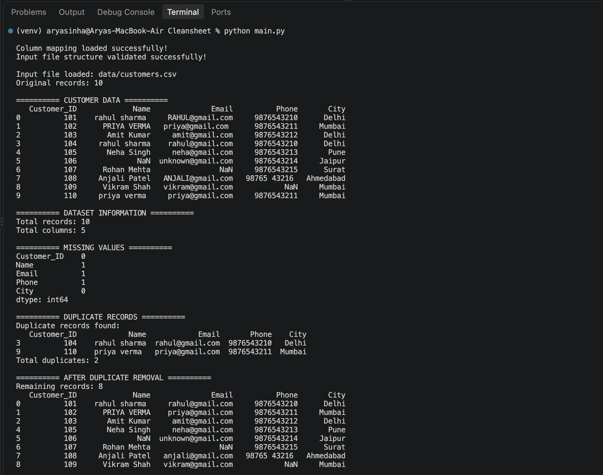
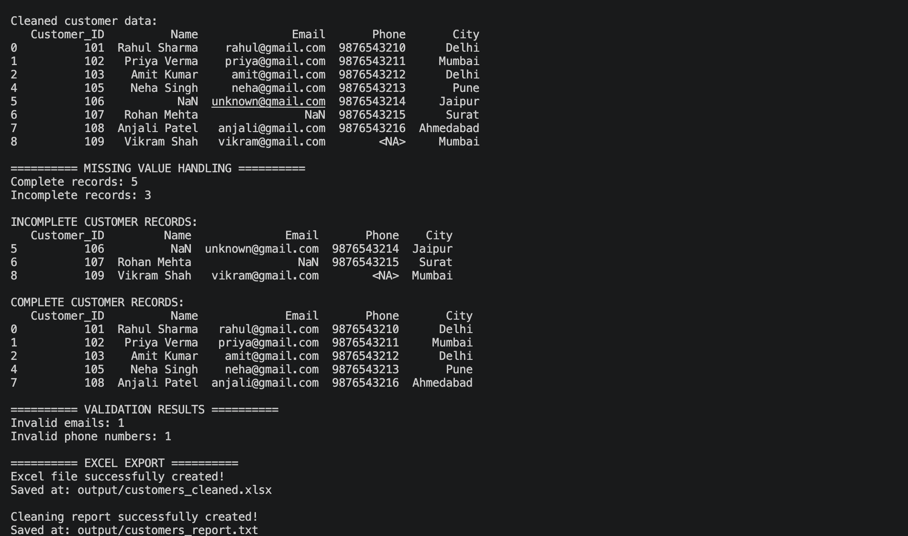
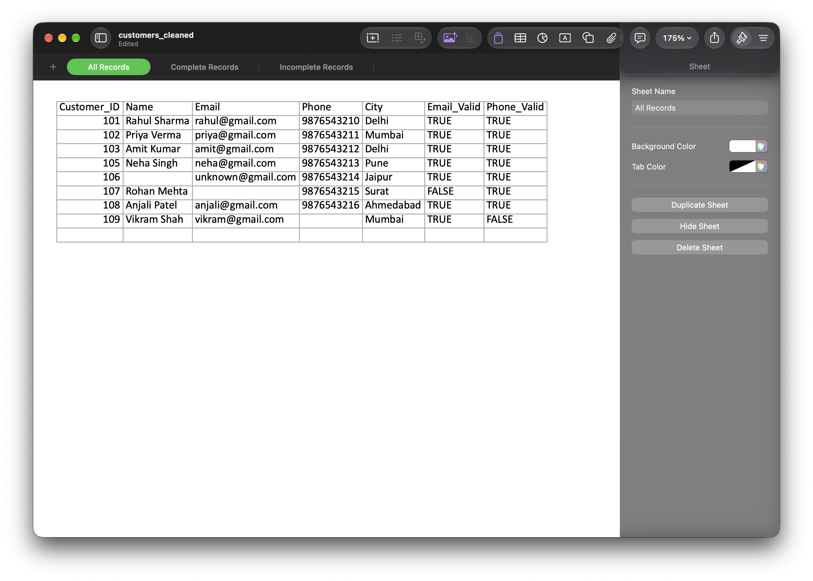
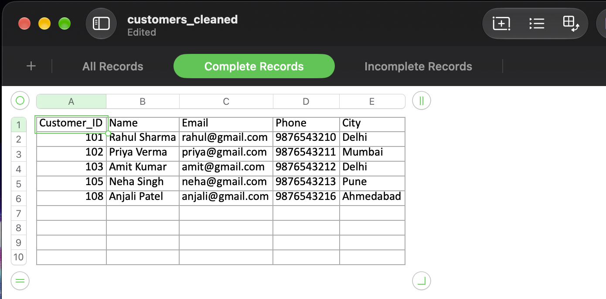
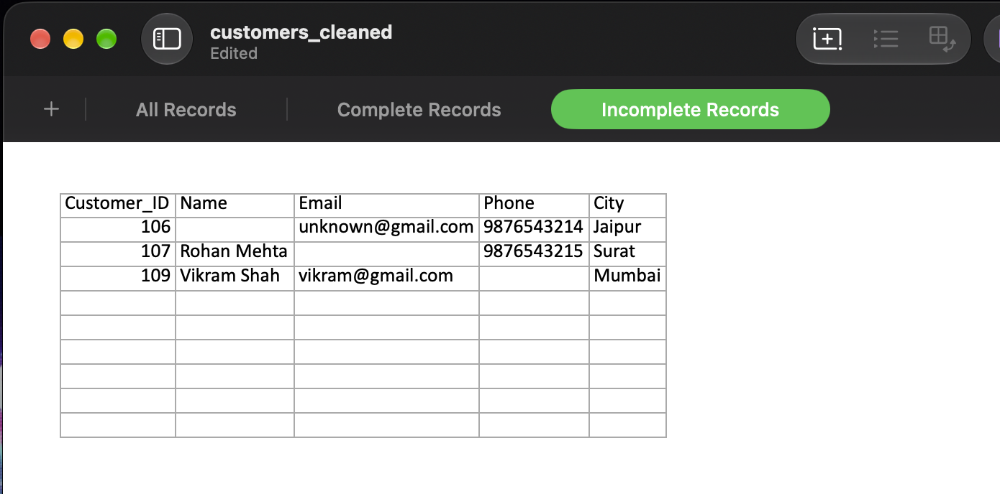
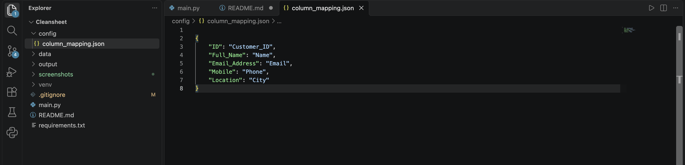

# CleanSheet – Excel & CSV Data Cleaning Automation

CleanSheet is a Python-based data cleaning tool that automates the process of cleaning customer data from CSV and Excel files.

It helps remove duplicate records, standardise customer information, identify missing values, validate email addresses and phone numbers, and generate clean Excel reports.

## Features

- Supports CSV and XLSX input files
- Removes duplicate customer records
- Standardises names, email addresses, phone numbers and cities
- Identifies complete and incomplete records
- Validates email addresses and phone numbers
- Supports configurable column mapping through JSON
- Exports cleaned data into Excel workbooks
- Generates an automatic cleaning summary report
- Handles invalid files and configuration errors

## Technologies Used

- Python
- Pandas
- OpenPyXL
- JSON

## Project Structure


```text
CleanSheet/
├── config/
│   └── column_mapping.json
├── data/
│   ├── customers.csv
│   ├── alternative_customers.csv
│   └── customers.xlsx
├── output/
├── screenshots/
│   ├── terminal-cleaning.png
│   ├── terminal-summary.png
│   ├── excel-output.png
│   ├── excel-complete-records.png
│   ├── excel-incomplete-records.png
│   └── column-mapping.png
├── tests/
│   └── test_cleaning.py
├── main.py
├── requirements.txt
├── README.md
└── .gitignore
```

## Installation

1. Clone this repository:

```bash
git clone https://github.com/aryasinha2217/Excel-Data-Cleaning-Automation.git
```

2. Navigate into the project:

```bash
cd Excel-Data-Cleaning-Automation
```

3. Create a virtual environment:

```bash
python3 -m venv venv
```

4. Activate it on macOS/Linux:

```bash
source venv/bin/activate
```

5. Install dependencies:

```bash
pip install -r requirements.txt
```

## How to Use

Run CleanSheet using the default sample file:

```bash
python main.py
```

Or provide your own CSV or Excel file:

```bash
python main.py data/customers.csv
```

You can also provide an Excel file:

```bash
python main.py data/customers.xlsx
```

## Output

CleanSheet automatically generates:

- An Excel workbook containing all records, complete records and incomplete records.
- A text report containing the cleaning summary and validation results.

Generated files are saved inside the `output/` directory.

## Running Tests

CleanSheet includes automated tests to verify its data cleaning functions.

Install pytest:

```bash
pip install pytest
```

Run the tests:

```bash
python -m pytest -v
```

The test suite currently contains 23 tests covering email validation, phone validation, duplicate removal, missing values and column mapping.

## Column Mapping

CleanSheet supports custom column names through:

`config/column_mapping.json`

This allows input files with different column headings to be mapped to the required customer data columns.

## Current Limitations

- Phone validation currently assumes 10-digit Indian phone numbers.
- Email validation checks email format, not whether the mailbox actually exists.
- The tool currently expects customer data with the required fields.

## Future Improvements

- Support for more data formats
- Configurable phone number validation by country
- More advanced data quality checks
- A graphical user interface
- Additional cleaning options

## Author

Developed as a Python portfolio project to demonstrate data cleaning and automation skills.

## Screenshots

### 1. Data Cleaning Process


### 2. Cleaning Summary


### 3. Excel Output


### 4. Complete Records


### 5. Incomplete Records


### 6. Column Mapping Configuration
